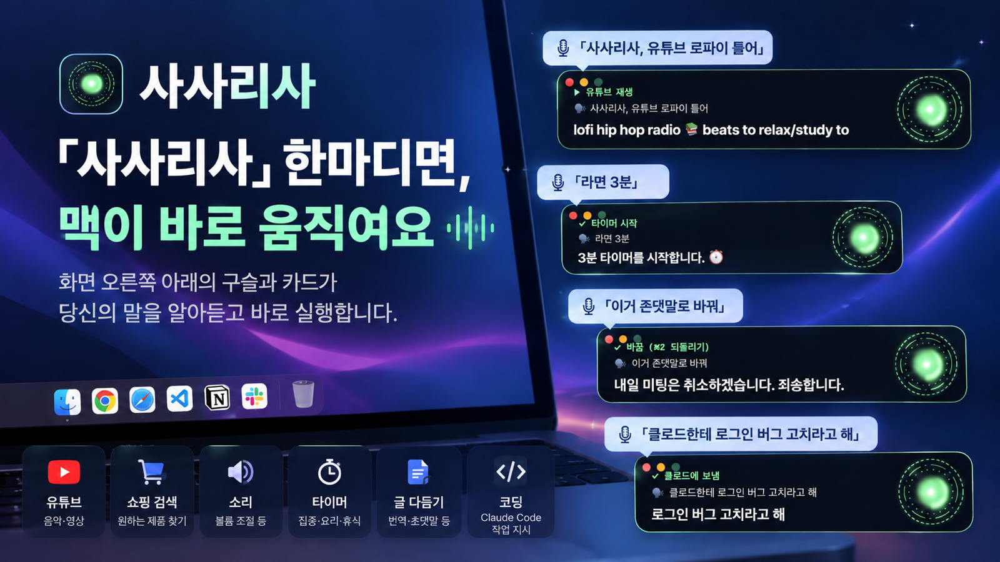

<div align="center">

# ◉ 맥 버틀러 (Mac Butler)

**「유튜브 틀어」부터 「로그인 버그 고쳐」까지, 말하면 됩니다.**
쉬운 일은 맥이 바로 하고, 코딩 같은 중요한 일은 클로드 코드에 말로 맡깁니다. 입코딩의 끝.




**[소개 페이지](https://mvcompany8500-web.github.io/mac-butler/)** · [English](README.md) · 무료 · 오픈소스(MIT)

</div>

## 이런 걸 말로 합니다

| 이렇게 말하면 | 이렇게 됩니다 |
|---|---|
| 「자비스」 (또는 오른쪽 ⌥ 톡) | 「띵」 → 30초 동안 이름 없이 계속 말하면 됨 |
| **오른쪽 ⌥ 누른 채 말하고 떼기** | 핸디처럼 누른 동안만 듣고, 떼면 바로 실행 (가장 정확·빠름) |
| 「아빠 왔어」 | 깨어나는 화면 + 인사 |
| 「크롬 열어」 · 「카톡 켜」 | 앱 열기 |
| 「유튜브 로파이 틀어」 → 「두 번째 거 틀어」 | 첫 영상 바로 재생, 번호로 다른 영상 |
| 「쿠팡에서 무선 이어폰 찾아 줘」 · 「에어팟 최저가」 | 쇼핑 검색 |
| 「안녕하세요 라고 써 줘」 · 「받아써 … 엔터 … 그만」 | 지금 칸에 입력 · 계속 받아쓰기 |
| 「클로드코드한테 내 프로젝트 점검해서 텔레그램으로 보내」 | 클로드 앱에 새 세션을 열고 일을 통째로 맡김 |
| 「지금 켜진 클로드 창에 로그인 버그 고쳐 줘」 | 보고 있는 클로드 창에 바로 입력 |
| 「라면 3분」 · 「5시에 회의 알려 줘」 | 타이머·알림 (알려 주기만 함) |
| 「강남역 가는 길」 · 「몇 시야」 · 「소리 30」 | 네이버 지도 · 바로 대답 · 소리 조절 |
| 「로파이 틀고 소리 줄이고 화면 꺼」 | 여러 명령을 한 번에, 차례로 |
| 「앞으로 '작업 시작' 하면 클로드 열고 로파이 틀어」 | 내 루틴 만들기 → 다음부터 「작업 시작」 한 마디 |
| (글 선택 후) 「이거 존댓말로 바꿔」 · 「영어로」 · 「맞춤법 고쳐」 | 선택한 글만 바꿔 넣음 — 보내기는 안 누름, ⌘Z로 되돌리기 |
| 그 밖에 아무거나 — 「지금 화면에 뭐 있어?」 | 클로드 코드가 알아서 처리하고 말로 대답 |

- 말하는 중이든 일하는 중이든 끼어들어 다음 말을 하면 바로 바꿉니다. 끝낼 땐 「됐어」.
- 클로드가 한 번 해낸 일은 기억해 뒀다가 다음엔 클로드 없이 즉시 합니다(토큰 0).

## 설치 (10분)

**준비물:** 애플 실리콘 맥(M1~M4), macOS 14 이상, 클로드 유료 요금제(Pro·Max·Team)

> **윈도우는 나중에 나와요.** 맥에서 먼저 공개하고, 윈도우판은 듣기·받아쓰기 속도를 맥만큼 맞춘 뒤 따로 출시할 예정입니다.

**1. 클로드 코드 설치·로그인** — [설치 안내](https://docs.claude.com/ko/docs/claude-code/setup)대로 설치하고, 터미널에서 `claude` 를 한 번 실행해 로그인합니다. (API 키 필요 없음, 쓰시는 요금제 그대로)

**2. 맥 버틀러 설치** — 터미널에 한 줄:

```bash
brew install --cask mvcompany8500-web/tap/mac-butler
```

> Homebrew(`brew`)가 없으면 [brew.sh](https://brew.sh) 첫 줄 명령부터 실행하세요.

**3. 처음 켜면 뜨는 준비 화면**에서 빨간 칸만 해결합니다 — 마이크·음성 인식·손쉬운 사용 허용, Whisper 모델 「받기」(874MB, 정확한 한국어 받아쓰기).

**4. 메뉴 막대의 ◉** 가 보이면 끝. 「자비스」라고 불러 보세요.

설정은 메뉴 → **설정…**(⌘,)에서 호칭(예: 「대표님」), 깨우는 말, 목소리, 언어(12개)를 바꿉니다.
핸디를 쓰고 계셨다면 핸디의 단어 사전이 자동으로 들어옵니다.

## 목소리 — 받자마자 됩니다

대답은 **맥에 들어 있는 목소리**로 합니다. 무료, 인터넷·가입 필요 없음. 설치된 것 중 가장 자연스러운 목소리를 알아서 고릅니다(한국어는 「유나」).

- **무료로 더 자연스럽게:** 시스템 설정 → 손쉬운 사용 → 읽기 및 말하기 → 시스템 목소리 → 목소리 관리… → **Premium**(프리미엄) 목소리 받기. 받으면 자동으로 그걸 씁니다.
- **시연 영상의 목소리는 유료 [ElevenLabs](https://elevenlabs.io)** 입니다. 내 열쇠를 설정 → 목소리에 넣으면 같은 방식으로 바뀌고, 크레딧이 떨어지면 맥 목소리로 돌아갑니다.

> 「영상이랑 목소리가 달라요」 → 위 이유입니다. 기능은 똑같고 목소리만 다릅니다.

## 다른 두뇌·목소리 꽂기

기본 두뇌는 **내 Claude 구독의 Claude Code** 입니다. 설정 → 두뇌에서 바꿀 수 있습니다: Claude API 열쇠, **GPT(OpenAI)**, Gemini, OpenRouter, Groq,
**내 컴퓨터 무료 모델(Ollama·LM Studio)**, 그 밖의 OpenAI 호환 주소. 어떤 두뇌를 골라도 손(누르기·입력·열기)은 같은 안전 장치를 지나고, 셸·파일은 없습니다.

목소리도 고를 수 있습니다: 맥 목소리(무료·기본), ElevenLabs, OpenAI, Azure(자연스러운 한국어 목소리·매달 무료 한도), 내 음성 서버(주소). 안 되면 늘 맥 목소리로 읽습니다.

열쇠는 설정 파일이 아니라 **맥 키체인**에만 저장됩니다(설정 창에 붙여 넣기).

## 안전

- **목소리는 맥 밖으로 나가지 않습니다.** 깨우는 말·받아쓰기 모두 맥 안에서 합니다. 고른 두뇌에게 넘기는 글자만 나갑니다(기본은 Anthropic, 유료 목소리를 켜면 대답 글자도 그쪽으로). 내 컴퓨터 모델을 고르면 아무것도 안 나갑니다.
- **안전 모드(기본, 어떤 두뇌든):** 비서는 맥 버틀러 도구 상자만 씁니다. 셸·파일 읽기/쓰기·외부 주소 읽기 불가, 터미널·비밀번호 앱·비밀번호 칸·시스템 설정·허락 창은 손대지 않습니다.
- **되돌릴 수 없는 단추는 묻습니다.** 보내기·결제·게시·삭제(메신저 엔터·웹 양식 제출 포함)는 「보낼까요?」 묻고 「응」 하면 누릅니다. 단축키를 누른 채 「보내」라고 하셨을 때만 바로 누릅니다(TV는 단추를 못 누르니까요).
- **비서가 클로드 세션에 일을 넘길 때는 늘 「맡길까요?」에 「응」.** TV·웹페이지 말에 속아 일을 시작하지 않습니다. 「바로 실행」은 대표님이 직접 「클로드한테 …」라고 말할 때만입니다.
- 누른 것·친 것·연 것은 `~/.macbutler/logs/actions.log` 에 남습니다.
- **다른 프로그램이 명령을 보낼 수 없습니다.** 애플 공증을 받은 앱입니다. 자세히: [SECURITY.md](SECURITY.md)

## 막힐 때

- 불러도 반응이 없다 → 메뉴 ◉ → 상태 점검에 ✗ 가 있는지 보세요. ✗ 를 누르면 해당 설정이 열립니다.
- 글자가 안 들어간다 → 「손쉬운 사용」 목록에서 Mac Butler를 지우고 다시 추가하세요.
- 한국어를 잘 못 알아듣는다 → 준비 화면에서 Whisper 모델을 받았는지, 오른쪽 ⌥ 누르고 말하기로 해 보세요.
- 그래도 안 되면 [이슈](../../issues/new/choose)에 남겨 주세요.

---

만든 사람: **turtle buff ai** — [YouTube @turtle_buff](https://www.youtube.com/@turtle_buff) · [turtle-buff.com](https://turtle-buff.com)
