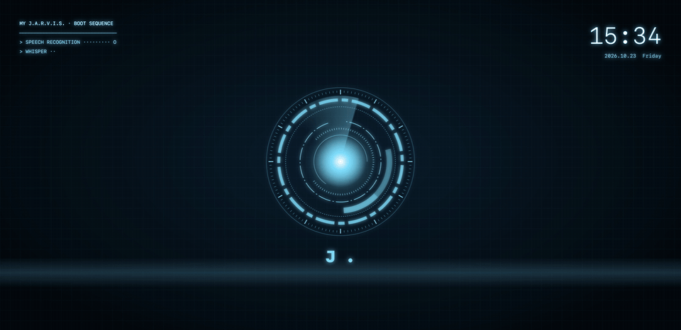
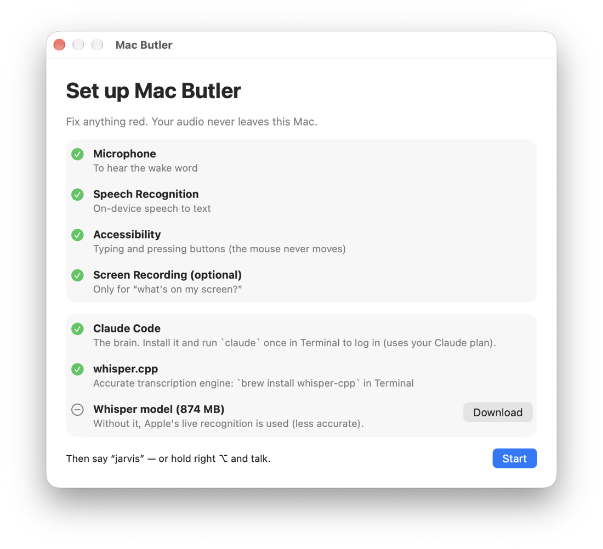
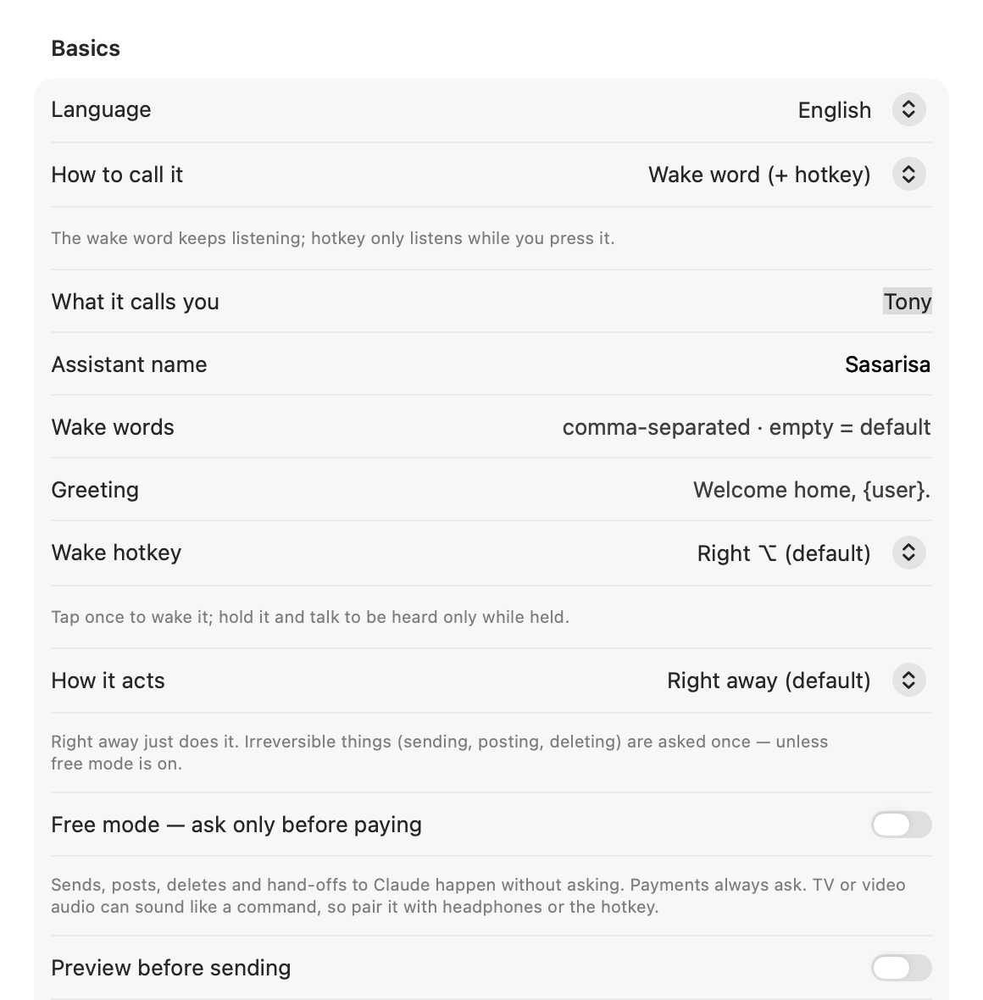

<div align="center">

# ◉ Mac Butler



**From “play some lofi” to “fix the login bug” — just say it.**
Small chores happen on your Mac in a second; real coding goes to Claude Code. Voice coding, all the way.

**No API key — uses your Claude plan** · **Audio never leaves your Mac** · **Asks before deleting, sending or paying**

[](../../releases/latest)
[](../../actions/workflows/ci.yml)
[](../../stargazers)
[](#requirements)
[](LICENSE)

```bash
git clone https://github.com/mvcompany8500-web/mac-butler.git && cd mac-butler && ./scripts/install.sh
```

[Install](#install) · [What it can do](#what-it-can-do) · [Privacy & safety](#privacy--safety) · [한국어](README.ko.md) · [Made by turtle buff ai](#made-by)

</div>

## Why

An always-listening voice assistant for macOS, Korean-first with English support. It answers to “Jarvis” by default — pick any name you like.
Dictation apps like [Handy](https://github.com/cjpais/Handy) turn your voice into text. Mac Butler goes one step further:
it keeps listening for its name, understands what you want, and **does it on your Mac** — without touching the keyboard
and without the mouse pointer jumping around. Anything it can't do on its own goes to Claude Code, which can read the
screen, run commands and use the web.

## What it can do

| You say | It does | Speed |
|---|---|---|
| “Jarvis” — the default wake word, change it in settings *(or tap right ⌥)* | chime → listening; keeps listening for 30 s, no wake word needed | instant |
| **Hold right ⌥ and talk**, release | push-to-talk like Handy — exact audio, runs the moment you let go | ~1 s |
| “아빠 왔어” / “daddy's home” | wake-up animation + spoken greeting | instant |
| “크롬 열어” / “open Chrome” | opens the app | < 1 s |
| “맥미니 가격 검색해” / “search for mac mini price” | Google search in your browser | < 1 s |
| “유튜브 로파이 음악 틀어” / “play lofi music on YouTube” → “두 번째 거” / “play the second one” | plays the first result, then any other result by number | ~1 s |
| “안녕하세요 라고 써 줘” / “type hello world” | types into the focused field | instant |
| “받아써” / “take dictation” … “엔터” … “그만” | continuous dictation with Whisper accuracy | ~1 s per sentence |
| “클로드코드한테 모든 프로젝트 점검해서 텔레그램으로 보내” / “ask Claude Code to …” | opens a **new Claude Code session** in the Claude app and types the task | ~2 s |
| “○○ 세션 클로드한테 ‘테스트’라고 전달해” | finds that session in the sidebar and sends the message | ~2 s |
| anything else — “지금 화면에 뭐 있어?”, “이 페이지 요약해서 메모에 붙여” | Claude Code works it out (screen, apps, web) and answers out loud | 4–20 s |

While it's talking — or while Claude is still working — just say the next thing: it stops and takes the new command. “됐어” / “that's all” ends the conversation.

**It grows.** Words your Mac's live recognizer keeps missing (names, product terms) are studied and added to its vocabulary after a few times; stale learned commands and temp files are swept automatically. The menu shows what it has learned.

**It gets faster the more you use it.** When Claude figures out how to do something (“pause the video” → press space), Mac Butler remembers the steps and next time does it instantly, without calling Claude. Say “no / 아니” right after and it won't learn it. The menu shows today's Claude calls and tokens.

**Any language.** Korean and English have built-in quick commands; Japanese, Chinese, Spanish, French, German, Portuguese, Italian, Vietnamese, Thai and Indonesian work through Claude, which answers in your language. It picks your Mac's language on first launch.

## How it works

```
mic ──► Apple on-device speech ──► wake word / live text on the HUD
          │ (utterance audio, 16 kHz)
          └──► whisper.cpp large-v3-turbo (local) ──► accurate text
                                                        │
                    quick commands (open, search, YouTube, type, Claude hand-off) ◄─┤
                                                        │
                          claude -p  (one warm Claude Code process, stream-json) ◄──┘
                                │  Bash · jax (Accessibility) · screencapture · WebSearch
                                ▼
                     your Mac  +  spoken answer (built-in macOS voice, or ElevenLabs)
```

* **No mouse movement.** Buttons, links and text fields are found by name through the Accessibility API (`jax`, ~0.1 s) and pressed directly.
* **Warm brain.** One Claude Code process stays open, so a command doesn't pay the 2–4 s start-up cost.
* **Whisper on demand.** The model loads when you call it and unloads after 3 idle minutes (~1 GB).

## Requirements

* macOS 14 or later, Apple Silicon recommended (tested on Mac mini M4, macOS 27)
* [Claude Code](https://docs.claude.com/en/docs/claude-code/setup) installed and logged in (`claude` in your terminal once). Uses your Claude plan.
* [Homebrew](https://brew.sh) — the installer adds `whisper-cpp` and `cliclick`
* ~1 GB disk for the Whisper model (optional but strongly recommended for Korean)
* Optional: an [ElevenLabs](https://elevenlabs.io) API key for a nicer voice

## Voice: works out of the box

It talks with **the built-in macOS voice** — free, offline, no sign-up. It picks the most natural one installed for your language
(Korean: Yuna, English: Samantha). Two optional upgrades:

* **Free:** System Settings → Accessibility → Spoken Content → System voice → Manage Voices… → download a **Premium** voice. It's used automatically.
* **Paid:** the voice in the demo video is [ElevenLabs](https://elevenlabs.io). Put your own API key in Settings → Voice. If the key runs out, it falls back to the macOS voice.

## Install

```bash
git clone https://github.com/mvcompany8500-web/mac-butler.git
cd mac-butler
./scripts/install.sh            # deps → Whisper model → build → ~/Applications → start at login
```

Or with Homebrew (signed & notarized by Apple):

```bash
brew install --cask mvcompany8500-web/tap/mac-butler
```

A setup window opens on first launch — it checks every permission live, links each fix, and downloads the Whisper model in-app (SHA-256 verified):



Then look for **◉J** in the menu bar. `./scripts/install.sh --no-model` skips the 874 MB download.

### Permissions

Open the **◉J** menu → *Status*. Each ✗ opens the right System Settings pane.

| Permission | Why | Without it |
|---|---|---|
| Microphone | hear the wake word | nothing works |
| Speech Recognition | on-device live text | nothing works |
| Accessibility | type, press keys and buttons | it can talk but not act |
| Screen Recording | Claude can look at the screen when asked | “what's on my screen?” fails |

> Releases are signed with Developer ID and notarized by Apple. **Building it yourself?** An ad-hoc signed build gets a new
> signature each time and macOS forgets the permissions — set `SIGN_ID` to a fixed certificate in `local.env` to keep them.

## Configuration

Menu bar → **Settings…** (⌘,) covers the common options — language, what it calls you, assistant name, wake words, voice, hotkey, Claude model:



Everything lives in `~/.macbutler/`:

| File | |
|---|---|
| `config.json` | all settings (below); restart from the menu after editing |
| `prompt.md` | optional — replaces the built-in personality/rules ([ko](Resources/prompts/prompt.ko.md) · [en](Resources/prompts/prompt.en.md)). `{user}`, `{assistant}`, `{screen}` are filled in |
| `voice/greeting.m4a`, `voice/boot.m4a` | optional — your own greeting line and boot sound |
| `logs/butler.log` | what it heard, decided and said |

```jsonc
{
  "language": "ko",                // "ko" or "en"
  "userName": "대표님",             // how it addresses you
  "assistantName": "자비스",
  "wakeWords": ["자비스", "헤이 자비스"],
  "greetingText": "어서 오십시오, {user}",
  "activation": "voice",           // "voice" = wake word + hotkey · "hold" = only while holding the hotkey
  "inputDevice": "",               // microphone UID ("" = system default) — list them: MacButler --devices
  "outputDevice": "",              // speaker UID for the voice and sounds
  "hotkey": "rightOption",         // tap = wake, hold = push-to-talk: rightOption | rightCommand | none
  "customWords": ["Claude", "GitHub"], // names you say often (imported from Handy automatically)
  "tts": "say",                    // "say" = built-in macOS voice (default) · "elevenlabs" = your key
  "sayVoice": "",                  // "" = most natural installed voice · or an identifier from Settings → Voice
  "elevenLabs": { "apiKeyFile": "~/.secrets/.env", "voiceId": "…", "model": "eleven_flash_v2_5" },
  "claudeModel": "sonnet",
  "whisperModel": "",              // default ~/.macbutler/models/ggml-large-v3-turbo-q8_0.bin
  "browserApp": "Google Chrome",
  "apps": { "브루": "Vrew" },       // extra spoken app names
  "silenceSec": 1.8, "followUpSec": 30
}
```

## Privacy & safety

* **Stays on your Mac:** microphone audio, wake-word detection, Whisper transcription, logs. No telemetry.
* **Leaves your Mac:** the text of commands that go to Claude Code (Anthropic) and, if enabled, answers sent to ElevenLabs for speech. Quick commands never leave the Mac.
* **Safe by default.** The assistant's brain can only use a fixed set of tools — no arbitrary shell, no file writes, no fetching URLs — and it can't press or type anything in terminals, code editors, the Claude app, System Settings, Keychain or permission prompts.
* **Asks before handing work to Claude Code.** A new session only starts after you say yes, so a voice from a TV or a web page can't start work on your computer.
* Other apps can't send it commands (owner-only control socket). Details and how to report a vulnerability: [SECURITY.md](SECURITY.md).
* Use the menu toggle to stop listening during calls and meetings.

## Known limitations

* Bluetooth headsets switch to low-quality mic mode while it listens — use a USB/built-in mic.
* With speakers (not headphones) you can still cut in — it compares the mic with how loud it is talking — but speak close to the mic; a loud room or very loud speakers make it harder.
* The Claude hand-off relies on the Claude desktop app's sidebar and prompt box labels; a UI update may break it.
* Quick commands are Korean and English only. Everything else depends on Claude.

<details>
<summary><b>Troubleshooting</b></summary>

* **Nothing happens when I say “Jarvis”** — menu → *Status*: all ✓? Check `~/.macbutler/logs/butler.log` for `heard[...]` lines.
* **It types nothing** — Accessibility is off, or was reset after a rebuild. Remove Mac Butler from the list and add it again.
* **“Claude Code is not installed”** — run `claude` once in Terminal, or set `"claudePath"` in config.json.
* **Slow** — check `uptime` / Activity Monitor; heavy builds or renders slow everything down. Whisper only loads after you call it.
* **Test without a mic** — `~/Applications/MacButler.app/Contents/Resources/bin/butler say "크롬 열어"`
* **Grammar self-test** — `~/Applications/MacButler.app/Contents/MacOS/MacButler --selftest`
</details>

## Roadmap

- [ ] Signed & notarized release + Homebrew tap (`brew install --cask mac-butler`)
- [x] Settings window (no JSON editing)
- [x] First-run setup window with in-app model download
- [x] Push-to-talk (hold the hotkey)
- [x] Learns what worked and replays it without Claude
- [ ] Quick-command grammars for Japanese, Spanish, …
- [ ] Custom wake-word engine (no Apple speech needed for the wake word)
- [ ] Plug-in commands: drop a small script in `~/.macbutler/commands/`

Have an idea? [Open an issue](../../issues/new/choose).

## Development

```bash
./build.sh                                  # → build/MacButler.app (no Xcode project needed)
build/MacButler.app/Contents/MacOS/MacButler --selftest
./scripts/uninstall.sh [--all]
```

`Sources/MacButler/` — `Ear` (mic + Apple speech), `Whisper`, `Brain` (Claude Code), `Commands` (quick-command grammar),
`Butler` (state machine), `Hands` (keyboard + Accessibility), `HUD`, `BootScene`, `Mouth` (TTS). `Tools/` — `jax`, `butler`, `jclick`, `jtype`.

Issues and pull requests are welcome — see [CONTRIBUTING.md](CONTRIBUTING.md). Quick-command grammars for more languages are especially wanted.

## Credits

[whisper.cpp](https://github.com/ggml-org/whisper.cpp) · [Claude Code](https://docs.claude.com/en/docs/claude-code) · [cliclick](https://github.com/BlueM/cliclick) ·
inspired by [Handy](https://github.com/cjpais/Handy).

*Mac Butler is an independent open-source project. It is not affiliated with, endorsed by or sponsored by Marvel, Disney or Anthropic. “Claude” is a trademark of Anthropic.*

---

## 한국어

**「유튜브 틀어」부터 「로그인 버그 고쳐」까지, 말하면 됩니다. 입코딩의 끝.**

**맥 버틀러(Mac Butler)** — 늘 듣고 있다가 「자비스」(기본 호출어, 설정에서 바꿀 수 있음) 하고 부르면 말로 맥을 움직이는 비서입니다.
쉬운 일은 맥이 바로 하고, 코딩 같은 중요한 일은 클로드 코드에 말로 맡깁니다. 키보드도 마우스도 안 씁니다.
쉬운 일(앱 열기·검색·유튜브·글 입력·받아쓰기)은 1초 안에 직접 하고, 나머지는 클로드 코드가 화면을 보고 처리한 뒤 말로 답합니다.
「클로드코드한테 ○○ 해서 보내」라고 하면 클로드 앱에 새 세션을 열어 일을 통째로 맡깁니다.

```bash
git clone https://github.com/mvcompany8500-web/mac-butler.git && cd mac-butler && ./scripts/install.sh
```

* 메뉴 막대 **◉J** → 상태 점검에서 ✗ 를 누르면 해당 권한 설정이 열립니다.
* 호칭은 `~/.macbutler/config.json` 의 `"userName"` (예: `"대표님"`), 인사말은 `"greetingText"`.
* 말하는 중에 말을 걸면 바로 멈추고 듣습니다. 끝낼 땐 「됐어」.
* 소리는 맥 밖으로 나가지 않습니다. 클로드에게 넘긴 지시 글과(켜 둔 경우) 일레븐랩스 읽기 글만 밖으로 나갑니다.

## Made by

**turtle buff ai** — AI로 혼자 일하는 법을 보여 주는 한국 채널.
This project is built and used daily on camera: [YouTube @turtle_buff](https://www.youtube.com/@turtle_buff) · [turtle-buff.com](https://turtle-buff.com)

If it's useful, a ⭐ helps others find it.

MIT License © 2026 MV Co., Ltd. (turtle buff ai)
